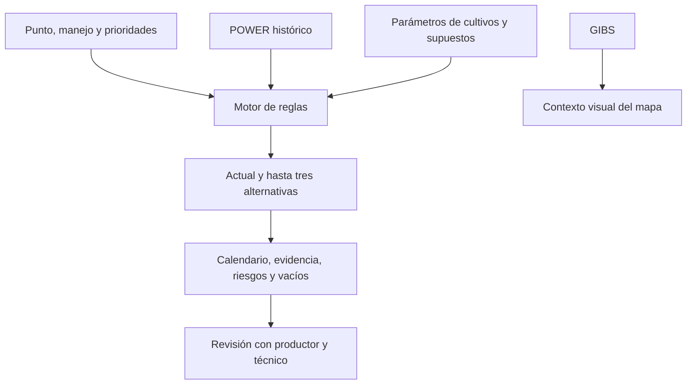

# MVP y demo

## Lo que ya existe

Selector de punto con Leaflet, presets de manejo actual, riego, pendiente, siete prioridades, escenarios de lluvia/temperatura, gráficos, calendario de 24 meses, explicaciones y traducciones ES/EN. POWER entra al motor; las capas GIBS se usan para visualización.

El mapa selecciona **un punto**, no dibuja el polígono del lote. El motor devuelve hasta tres alternativas que pasan sus filtros; no garantiza cuatro tarjetas para todos los lugares.

## Recorrido recomendado

1. Mostrar un punto de Santiago del Estero y aclarar si es ilustrativo.
2. Elegir soja–maíz como preset, sin atribuirlo a un productor no entrevistado.
3. Mostrar agua, pendiente y prioridades; distinguir inputs reales de supuestos.
4. Abrir la rotación actual y hasta tres alternativas con calendario común.
5. Explicar un indicador: fórmula, fuente, período y limitación.
6. Aplicar −20 % de lluvia / +2 °C y mostrar un cambio del conjunto o puntaje.
7. Cerrar con qué debe verificar el productor o técnico en el lote.

## Ejecución reproducida

En el punto predeterminado `-27.7834, -64.2642`, con POWER 2011–2025, secano, pendiente suave y prioridades predeterminadas, el escenario base devolvió actual + sorgo/soja, algodón/maíz y algodón/trigo/soja de segunda, incluyendo las coberturas que agrega el motor. Con −20 % de lluvia / +2 °C, la tercera alternativa fue girasol/vicia/maíz.

Es un resultado del algoritmo actual, no una recomendación validada. Los detalles se guardaron en [resultado-motor.json](../99%20Recursos/Revision%20prototipo/resultado-motor.json).

## Qué debe explicar cada opción

Razón, valores con unidad y fuente, beneficio potencial, costo o contrapartida, riesgos y datos faltantes. El ranking es un índice de preferencia bajo supuestos; no probabilidad de éxito, rentabilidad ni porcentaje de agua ahorrada.

La meta de cuatro tarjetas es de diseño; las decisiones de alcance se revisaron en [[Consigna oficial y encaje]].

## Listo para presentación cuando

- [x] Pruebas existentes y build aprobados.
- [x] Ejecución del motor con una consulta NASA real guardada.
- [ ] Aplicar las correcciones P0 de [[Cambios prioritarios]].
- [ ] Confirmar punto, tipo de caso y calendario actual.
- [ ] Registrar suelo, parámetros de cultivos y restricciones con fuente y estado conocido/desconocido.
- [ ] Verificar recorrido en navegador y celular; capturar pantallas reales.
- [ ] Preparar carga desde archivo o caché persistente para la demo.
- [ ] Revisar textos de entrega contra funciones comprobadas.
- [ ] Confirmar el formato de presentación aplicable al equipo.
